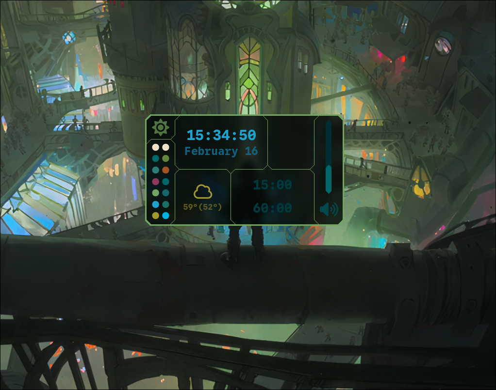
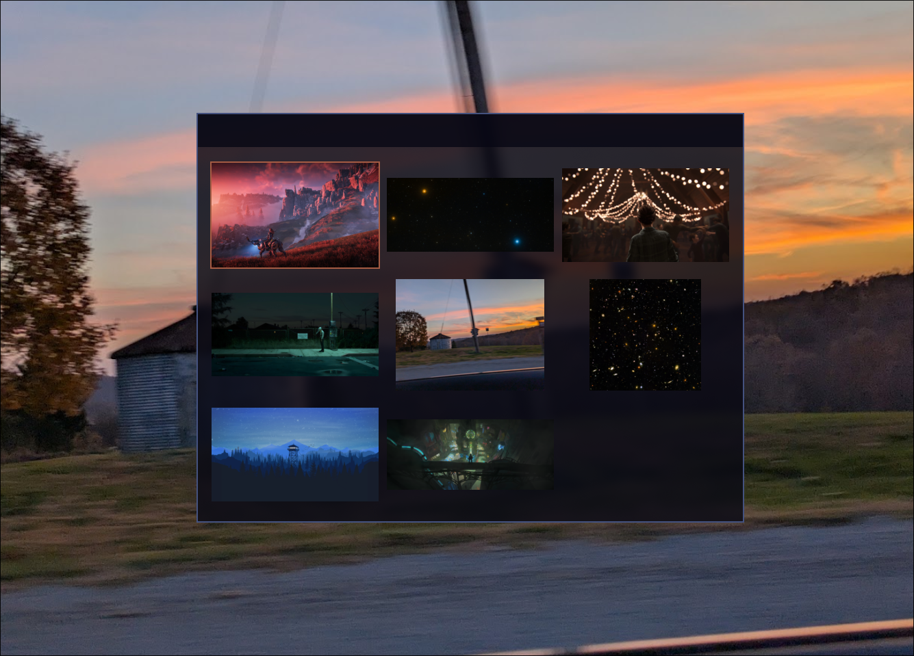
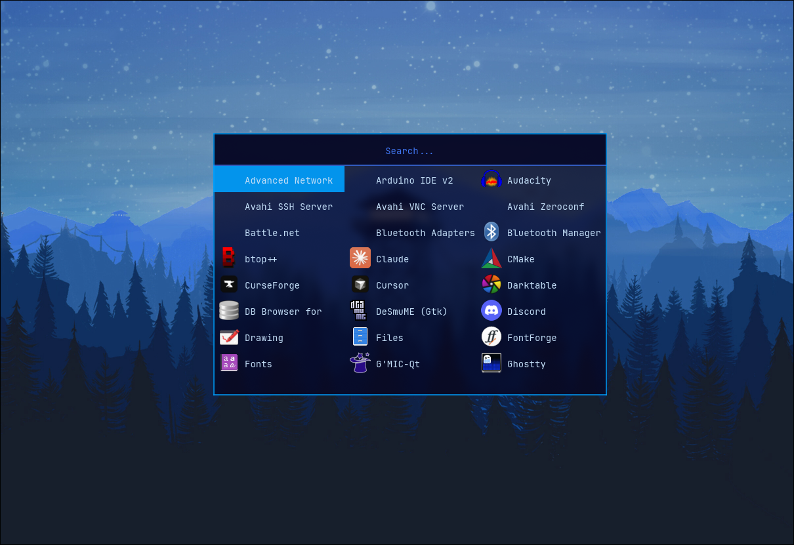

# widgets

Bespoke Wayland desktop widgets written from scratch in Rust against smithay-client-toolkit + tiny-skia. No widget frameworks.

## Widgets

### wavedash
Floating status overlay — clock, weather, pomodoro timers with an alarm, volume control, notification pause, theme toggle.

The audio icon uses left-click to toggle mute, right-click to switch between the two configured outputs, and middle-click to open pavucontrol. Brightness and battery bars appear on machines that have a backlight / battery.



### wallrun
Image picker overlay — thumbnail grid, fuzzy search, keyboard + mouse nav.



### grimoire
App launcher / dmenu replacement — filterable list with icons, fuzzy search, frecency sorting.



### tincture
Colorscheme editor — drag a walrs palette around an OKLCH wheel and reapply the theme live.

### evoke
Speech-to-text overlay — streams the mic to OpenAI's realtime transcription, shows the words live in an editable box, optionally cleans them up with an LLM, then types the result into the window you were in.

## Stack

- smithay-client-toolkit 0.20 (Wayland layer-shell, input, SHM buffers, calloop)
- tiny-skia (CPU rendering)
- cosmic-text (text shaping/glyph rendering)
- walrs (colorscheme integration from wallpaper)

## Build

Cargo workspace with a unified Makefile:

```
make install          # build + install all widgets to ~/.local/bin/
make install W=wavedash  # build + install just one
```

## Config

- Config files: `~/.config/widgets/<name>.toml`
- State files: `~/.local/state/widgets/<name>.toml`
- Color templates: `~/.config/walrs/templates/`

All TOML keys are optional. Background opacity is **not** a TOML key — set `background_opacity = 0.0..1.0` in the widget's color file (generated from its walrs template).

### wavedash

| key | default |
| --- | --- |
| `color_file` | `~/.cache/wal/colors-wavedash.toml` |
| `font` | `~/.local/share/fonts/GoogleSansCode-Bold.ttf` |
| `icon_font` | `/usr/share/fonts/OTF/Font Awesome 7 Free-Solid-900.otf` |
| `font_size` | `39.0` (accepted but unused) |
| `timer1_duration` | `3600` |
| `timer2_duration` | `900` |
| `bt_device_1` | `AC:BF:71:08:A1:D6` |
| `audio_device_2` | `EC:81:93:AC:8B:60` (BT MAC or unique substring of the sink name) |
| `weather_lat` | `0.0` |
| `weather_lon` | `0.0` |
| `weather_max_age` | `3600` |
| `alert_sound` | `~/.config/widgets/wavedash-alarm.wav` |
| `alert_volume` | `1.0` |

### wallrun

| key | default |
| --- | --- |
| `color_file` | unset |
| `font` | `~/.local/share/fonts/GoogleSansCode-Regular.ttf` |
| `font_size` | `20.0` |
| `label_font_size` | `14.0` |
| `show_labels` | `true` |
| `columns` | `3` |
| `window_width` | `800` (or `"fit"`) |
| `window_height` | `600` (or `"fit"`) |

### grimoire

| key | default |
| --- | --- |
| `color_file` | unset |
| `font` | `~/.local/share/fonts/GoogleSansCode-Regular.ttf` |
| `font_size` | `18.0` |
| `comment_font_size` | `14.0` |
| `icon_size` | `32` |
| `window_width` | `600` |
| `window_height` | `400` |
| `terminal` | `ghostty -e` |
| `columns` | `1` |
| `show_comments` | `true` |
| `search_comments` | `false` |
| `center_items` | `false` |

### tincture

| key | default |
| --- | --- |
| `font` | `~/.local/share/fonts/GoogleSansCode-Regular.ttf` |

Usage: `tincture [image]` — edits the walrs cache entry for that image (defaults to the current wallpaper). Normal window (app_id `tincture`), not an overlay — `windowrule = float, class:^(tincture)$` is worth adding.

### evoke

| key | default |
| --- | --- |
| `color_file` | `~/.cache/wal/colors-evoke.toml` |
| `openai_api_key` | (required) |
| `anthropic_api_key` | (required for `[cleanup]`) |
| `font` | `~/.local/share/fonts/GoogleSansCode-Regular.ttf` |
| `font_size` | `16.0` |
| `width` | `600` |
| `max_lines` | `8` |
| `margin` | `0.1` |
| `border_width` | `2` |
| `bar_width` | `2` |
| `bar_gap` | `1` |
| `scale` | `20.0` |
| `model` | `gpt-live-transcribe` |
| `delay` | `minimal` |
| `language` | `en` |
| `keywords` | `[]` |
| `send` | `ime` (or `paste`) |
| `[replace]` | whole-word fixes, e.g. `Hyperland = "Hyprland"` |
| `[cleanup]` | optional LLM cleanup via the Anthropic API: `model` (`claude-haiku-5-5`), `prompt` |

Usage totals (audio seconds / tokens as reported by the API) accumulate in `~/.local/state/widgets/evoke.toml`.
